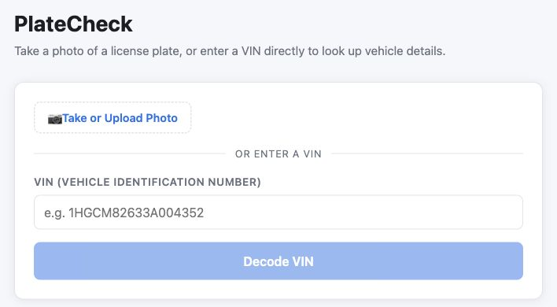
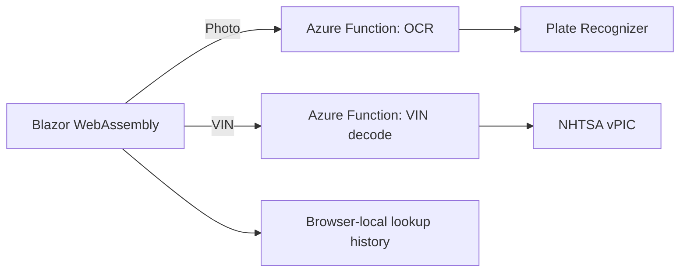

# PlateCheck

A **Blazor WebAssembly + Azure Functions** application for identifying vehicle details from a photo or decoding a VIN.

[Open the application](https://platecheck.dallaswaldrop.com/) · [About the developer](https://www.dallaswaldrop.com/)



## Try it

No sign-in is required. Enter the example VIN shown in the form and select **Decode VIN**, or upload a vehicle photo for plate recognition and vehicle predictions. Photo analysis depends on the configured Plate Recognizer service and its available quota.

These are two distinct paths: photo analysis recognizes visible information and predicts vehicle attributes; VIN decoding retrieves vehicle attributes from NHTSA. The app does not look up an owner or retrieve a VIN from a plate number.

## How it works



| Part | Responsibility |
| --- | --- |
| [`Client`](Client) | C# / Blazor interface, loading and error states, and lookup history |
| [`Api`](Api) | .NET 8 isolated Azure Functions; calls external APIs and maps their responses |
| [`Shared`](Shared) | C# request and result models shared by client and API |
| [Deployment workflow](.github/workflows/azure-static-web-apps-lively-pebble-0c8bfc710.yml) | Builds and deploys to Azure Static Web Apps |

The browser calls `POST /api/ocr-plate` with image bytes or `GET /api/decode-vin?vin=...`. The Plate Recognizer credential stays in the Functions environment. Photo results can be supplemented with a VIN entered by the user.

## Design decisions and limits

- **One language across the app:** Blazor and Functions share C# result models, while the UI and integrations have separate responsibilities.
- **Separate data sources:** Plate Recognizer supplies OCR and vehicle predictions; NHTSA supplies VIN-decoded attributes. A photo prediction is not a verified vehicle record.
- **No account system:** lookup history stays in the browser's local storage. Photos are sent to Plate Recognizer for analysis, and VINs are sent to NHTSA for decoding.
- **External-service dependency:** availability, quotas, image quality, and incomplete source data can affect results. The functions translate unsuccessful upstream HTTP responses into gateway errors; the client displays loading and error states.
- **Personal application scope:** automated tests and server-side rate limiting are not currently implemented in this repository. Broader public use would need those protections and stronger server-side input validation.

## Local development

Prerequisites: .NET 8 SDK, Azure Functions Core Tools v4, and Azurite for local storage emulation. A Plate Recognizer API key is needed for photo analysis; VIN decoding does not require it.

1. Create `Api/local.settings.json` (already ignored by Git):

   ```json
   {
     "IsEncrypted": false,
     "Values": {
       "AzureWebJobsStorage": "UseDevelopmentStorage=true",
       "FUNCTIONS_WORKER_RUNTIME": "dotnet-isolated",
       "PLATE_RECOGNIZER_API_KEY": "YOUR_LOCAL_API_KEY"
     }
   }
   ```

2. Run `azurite` in its own terminal. In another terminal, start the Functions host from `Api`:

   ```bash
   func start --port 7071 --cors http://localhost:5059
   ```

3. In another terminal, from the repository root:

   ```bash
   dotnet run --project Client --launch-profile http
   ```

4. Open `http://localhost:5059`. The committed development configuration points the client to `http://localhost:7071/`.

To compile both projects from the repository root:

```bash
dotnet build LicensePlateLookup.sln
```

## Deployment

The existing GitHub Actions workflow deploys `Client` and `Api` to Azure Static Web Apps on pushes to `master`. Configure `PLATE_RECOGNIZER_API_KEY` as an application setting in Azure, and use the deployment token expected by the workflow. Keep credentials out of browser configuration and source control.
